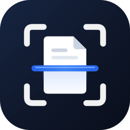
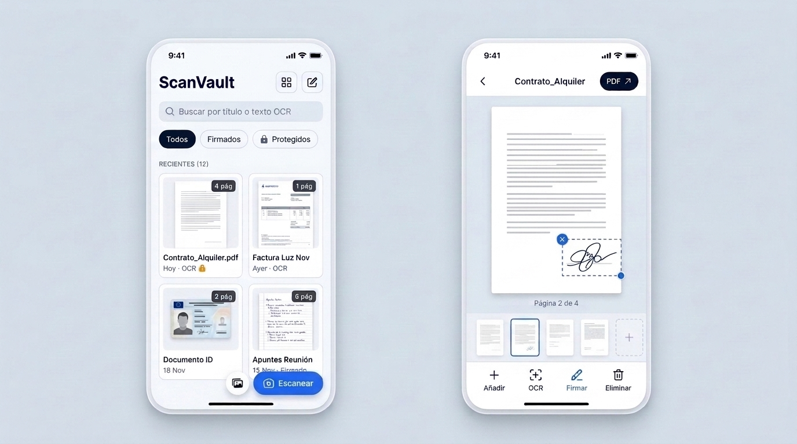
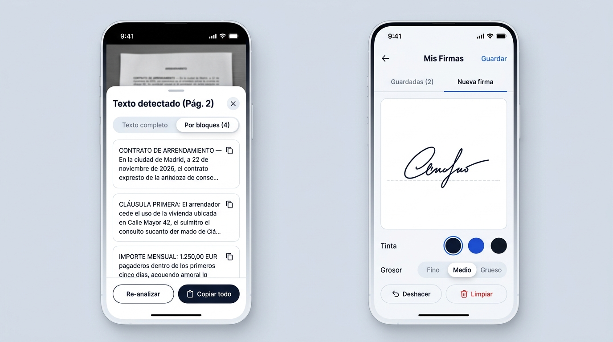
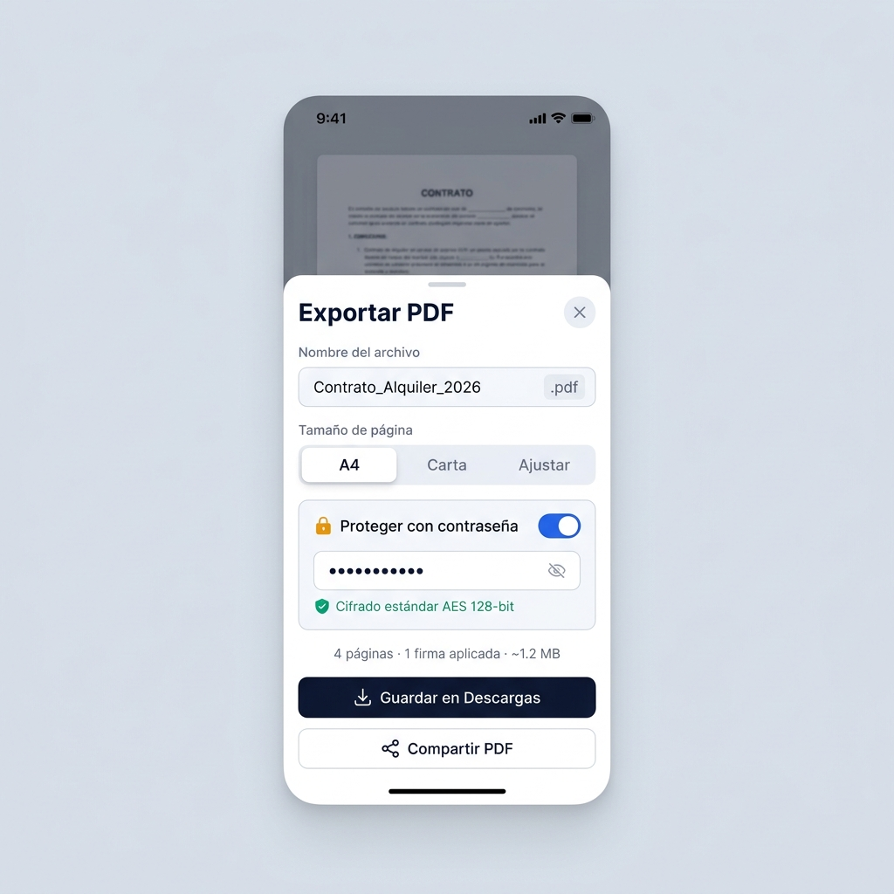

<p align="center">
  
</p>

<h1 align="center">Scanly</h1>

<p align="center">
  <strong>Escáner de documentos PDF minimalista, privado y 100% offline para Android.</strong><br/>
  Sin marcas de agua, sin cuentas ni suscripciones.
</p>

<p align="center">
  <a href="https://github.com/Javier-GarciaP/scanly/releases/latest">
    
  </a>
</p>

---

## Capturas de la aplicación

### Bóveda de documentos y editor de páginas


### Extractor de texto OCR offline y estudio de firmas


### Exportación y cifrado de PDF (AES 128-bit)
<p align="center">
  
</p>

---

## Descargar e instalar (APK)

1. Ve a la sección de [**Releases**](https://github.com/Javier-GarciaP/scanly/releases/latest).
2. Descarga el archivo `Scanly-v1.0.0.apk`.
3. Ábrelo en tu teléfono Android y permite la instalación desde fuentes desconocidas si el sistema lo solicita.

---

## Funciones principales

- **Escaneo multipágina profesional (Google ML Kit Document Scanner):** detección automática de bordes, recorte con corrección de perspectiva, filtros de mejora e importación desde galería.
- **Generación de PDF sin marcas de agua (PDFBox Android):** tamaños `A4`, `Carta` o `Ajustar` directamente en el dispositivo.
- **OCR 100% offline (ML Kit Text Recognition):** extrae texto completo o por bloques, copia con un toque y busca documentos por su contenido en SQLite.
- **Firmas digitales reutilizables:** dibuja tu firma con tinta y grosor personalizables, guárdala como PNG transparente, arrástrala y redimensiónala sobre cualquier página.
- **Protección con contraseña:** cifrado estándar **AES 128-bit** opcional al exportar el PDF.
- **Organización minimalista:** vista en cuadrícula o lista, carpetas con colores y filtros rápidos (`Todos`, `Firmados`, `Protegidos`).
- **Exportación directa:** guarda directo en `Descargas/Scanly/` o comparte por cualquier app.

---

## Stack técnico

- **Frontend móvil:** React Native + Expo + TypeScript
- **Módulo nativo Android (`modules/doc-engine`):** Kotlin, Google ML Kit Document Scanner, ML Kit Text Recognition y Apache PDFBox Android
- **Almacenamiento local:** `expo-sqlite` + `expo-file-system`

---

## Compilar el APK localmente

```bash
npm install
npx expo prebuild --platform android --clean
export ANDROID_HOME="$HOME/Android/Sdk"
cd android
./gradlew assembleRelease -PreactNativeArchitectures=arm64-v8a,armeabi-v7a
```

El APK compilado se genera en:
`android/app/build/outputs/apk/release/app-release.apk`

Para instalarlo por USB con Depuración USB activada:

```bash
~/Android/Sdk/platform-tools/adb install -r android/app/build/outputs/apk/release/app-release.apk
```

---

## Compilación automática en GitHub

Este repositorio incluye el flujo [`.github/workflows/release-apk.yml`](./.github/workflows/release-apk.yml), que compila automáticamente el `.apk` en GitHub Actions y lo publica en **GitHub Releases** cada vez que se crea un tag `v*` (por ejemplo, `v1.0.0`) o cuando se ejecuta manualmente desde la pestaña **Actions**.
